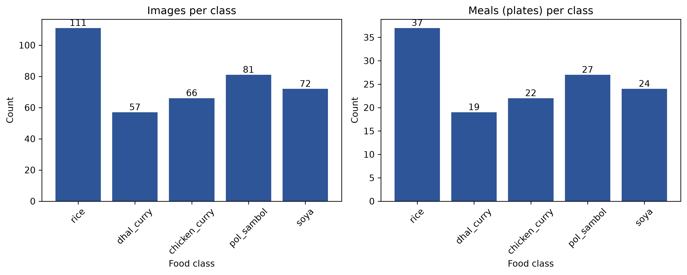
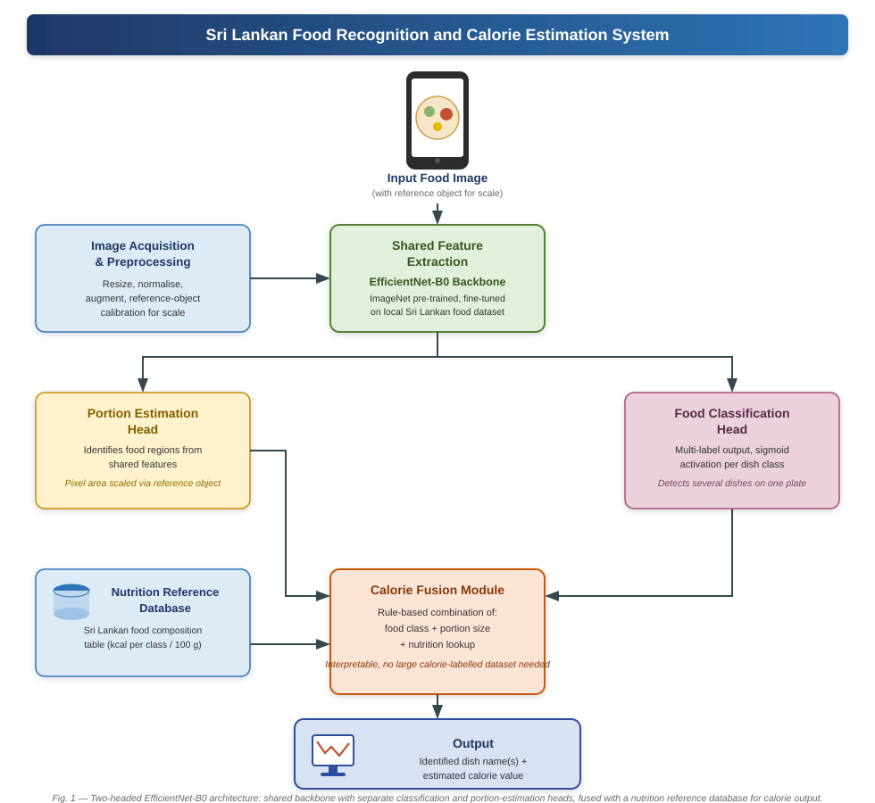

# 🥘 Sri Lankan Food Recognition and Calorie Estimation System

> Computer vision system for identifying Sri Lankan meals and estimating their
> calorie content. This repository currently contains the data pipeline, the
> leakage-free cross-validation setup and a ResNet-50 baseline. The proposed
> EfficientNet-B0 model and the portion/calorie module are still in progress.

| | |
|---|---|
| **Module** | IT41043 - Intelligent Systems, Horizon Campus |
| **Team** | G. Rashmi Dulashani (ITBIN-2313-0031) & H.M. Imashi Dilshani (ITBIN-2313-0025) |
| **Module Leader** | Mr. Isuru Madusanka Samarappulige |

---

## 🧩 Research Gap
Existing food recognition and calorie estimation systems are trained and tested
on structured, clearly separated Western or East Asian meals. Sri Lankan meals
(rice and curry, kottu, hoppers, string hoppers) are visually complex, mixed on
one plate, and vary widely in portion size. No existing dataset or model has
been tested against this specific challenge.

## 📊 Project Status

| Component | Status | Notes |
|---|---|---|
| Data collection (Phase 1) | ✅ Done | 5 food classes, see [Dataset](#-dataset) |
| Data pipeline (labels, quality check, duplicates, folds) | ✅ Done | `src/data/` |
| ResNet-50 baseline (4-fold CV) | ✅ Done | see [Results](#-results-resnet-50-baseline) |
| EfficientNet-B0 comparison | 🔄 In progress | branch `feature/efficientnet-b0` |
| ArUco-based portion and calorie estimation | ⬜ Not started | marker detection is already used for scale |
| Statistical testing and research paper | ⬜ Not started | |

## 📁 Project Structure
```
Sri-Lankan-Food-Calorie-Estimation/
├── data/
│   ├── raw/                  # original photos (not in git)
│   ├── processed/            # generated packages (not in git)
│   └── metadata/
│       ├── classes.csv       # class list (phase 1 = classes used so far)
│       ├── meals_log.csv     # collection log: meal id, collector, location, labels
│       ├── image_labels.csv  # one row per image file: multi-hot labels + marker scale
│       ├── photo_table.csv   # one row per distinct photo: plate id + labels
│       └── folds.csv         # cross-validation fold of every distinct photo
├── src/
│   ├── data/                 # labels, quality check, duplicates, folds, Dataset class
│   ├── training/             # train_resnet50.py
│   ├── evaluation/           # evaluate.py (Macro-F1, AUC-ROC)
│   └── visualization/        # plot_class_distribution.py
├── results/
│   ├── figures/              # class_distribution.png
│   └── metrics/              # predictions, training logs, metrics per fold
├── notebooks/
├── docs/                     # milestone reports and diagrams
├── requirements.txt
└── README.md
```
> `data/raw/` and `data/processed/` are excluded from version control because
> image data is large. `data/metadata/quality_report.csv` and
> `duplicate_groups.csv` are generated by the scripts below.

## ⚙️ Setup
```bash
git clone https://github.com/RashmiDulashani/Sri-Lankan-Food-Calorie-Estimation
cd Sri-Lankan-Food-Calorie-Estimation

python -m venv .venv
.venv\Scripts\activate        # Windows
# source .venv/bin/activate   # Linux / macOS

pip install -r requirements.txt
```
`requirements.txt` covers the data and evaluation scripts. Model training
needs PyTorch and a GPU; it was run on Google Colab (T4), where `torch` and
`torchvision` are already installed.

## 🗂️ Dataset
- **Source:** locally photographed Sri Lankan meals (home kitchens and a
  canteen), top-view, with a printed ArUco marker (DICT_4X4_50, id 0, black
  square 5 cm) placed beside the plate for scale.
- **Classes (phase 1, 5):** `rice`, `dhal_curry`, `chicken_curry`,
  `pol_sambol`, `soya`. Eight more classes are listed as phase 2 in
  `classes.csv` and have not been collected yet.
- **Labels:** multi-label per image; a plate can contain several dishes.
- **Size (actual):** 300 image files, of which **46 are distinct photographs**
  (the other 254 files are exact byte-for-byte copies). The distinct photos
  belong to **16 plates**. Copies are kept in `data/raw/` but are not used for
  training or evaluation, and all results below are on the 46 distinct photos.
- **Plates per class:** rice 8, soya 5, dhal_curry 4, pol_sambol 4,
  chicken_curry 2.
- **Marker detected:** 296 of 300 image files.
- **Not collected yet:** weighed portions (no ground-truth calories), the
  Roboflow "SriLankanFoods" set (planned as supplementary data only).
- **Ethics:** no personally identifiable information collected; consent
  obtained from staff/hosts before photographing meals.
- The photographs are not included in this repository.



## 🔁 Reproducing the pipeline
Run from the repository root, with the photos in `data/raw/` named
`M0001_a.jpg`, `M0001_b.jpg`, ... and `data/metadata/meals_log.csv` filled in.

```bash
python src/data/build_labels.py         # image_labels.csv (+ ArUco scale per image)
python src/data/quality_check.py        # quality_report.csv (blur, brightness, duplicates)
python src/data/find_duplicates.py      # duplicate_groups.csv
python src/data/build_photo_table.py    # photo_table.csv (one row per distinct photo)
python src/data/make_folds.py           # folds.csv (plate-level CV folds)
python src/data/export_colab_package.py # zip of distinct photos + metadata for Colab
```

Training (Google Colab, after unzipping the package to `/content/data`):
```bash
python -m src.training.train_resnet50 --photo-dir /content/data/photos --meta-dir /content/data/metadata
```

Evaluation (after copying the output CSVs to `results/metrics/`):
```bash
python src/evaluation/evaluate.py
```

## 🧠 Model
**Implemented baseline:** ResNet-50 pretrained on ImageNet, backbone frozen,
new last layer (5 outputs, sigmoid, multi-label).

| Setting | Value |
|---|---|
| Loss / optimizer | BCEWithLogits / Adam, lr 1e-3 |
| Epochs / batch size | 15 / 8 |
| Input | 224 x 224, ImageNet normalisation |
| Augmentation (training only) | horizontal flip, rotation up to 15 deg, brightness/contrast 0.2 |
| Decision threshold | 0.5 |
| Seed | 42 |

**Proposed model (in progress):** shared EfficientNet-B0 backbone with a
multi-label classification head, portion estimation using the ArUco scale, and
a rule-based calorie fusion with a nutrition reference table.



## 📈 Evaluation
- **Metrics:** Macro-F1 (primary) and macro AUC-ROC for classification; MAE and
  MAPE for calories (not yet computed, no calorie ground truth yet).
- **Validation:** 4-fold cross-validation **at plate level**. All photos of a
  plate always stay in the same fold, so no plate appears in both training and
  validation. Each plate is stratified by its rarest class.
- **Classes absent from a fold's validation set** (chicken_curry in folds 1 and
  2) are skipped for that fold instead of being scored as 0.

## 📊 Results: ResNet-50 baseline
Validation folds contain only 4 plates each, so these numbers are unstable and
are a pipeline check, not final results.

| Fold | Photos | Macro-F1 | Macro AUC-ROC |
|---|---|---|---|
| 0 | 12 | 0.275 | 0.756 |
| 1 | 10 | 0.379 | 0.810 |
| 2 | 12 | 0.400 | 0.843 |
| 3 | 12 | 0.360 | 0.852 |
| **Mean ± SD** | | **0.353 ± 0.055** | **0.815 ± 0.044** |

Per-fold values: `results/metrics/resnet50_metrics_by_fold.csv`.

## ⚠️ Limitations and changes from the proposed methodology
- **Small dataset:** 46 distinct photos from 16 plates and 5 classes, instead of
  the planned 3,000-4,000 images and 18-20 classes. chicken_curry appears in
  only 2 plates.
- **4-fold instead of 5-fold CV**, because 16 plates cannot fill 5 folds.
  With so few folds, a Wilcoxon test cannot reach p < 0.05; the planned
  statistical comparison needs more plates.
- **Plate-level splitting** was added to prevent leakage between near-identical
  photos of the same plate.
- **Portion estimation:** the learned portion head was replaced by classical
  calibration with the ArUco marker, because no region labels exist. It is not
  implemented yet.
- **No calorie ground truth:** food was not weighed, so MAE/MAPE cannot be
  computed yet.
- Most plates contain a single dish; only a minority are mixed plates.

## 🔭 Future work
EfficientNet-B0 comparison, ArUco portion and calorie module, more plates
(target 50+) and the remaining classes, weighed portions for calorie ground
truth, statistical testing, and the research paper.

## 📄 Milestone Documents
| Document | Location |
|---|---|
| Milestone 1 - Research Proposal | [milestone1_research_proposal.pdf](docs/milestone1_research_proposal.pdf) |
| Milestone 2 - Methodology & Data Description | [milestone2_report.pdf](docs/milestone2_report.pdf) |
| Preprocessing Pipeline | [preprocessing_pipeline.svg](docs/preprocessing_pipeline.svg) |
| System Architecture Diagram | [architecture_diagram.svg](docs/architecture_diagram.svg) |
| Baseline Diagram | [baseline_diagram.svg](docs/baseline_diagram.svg) |